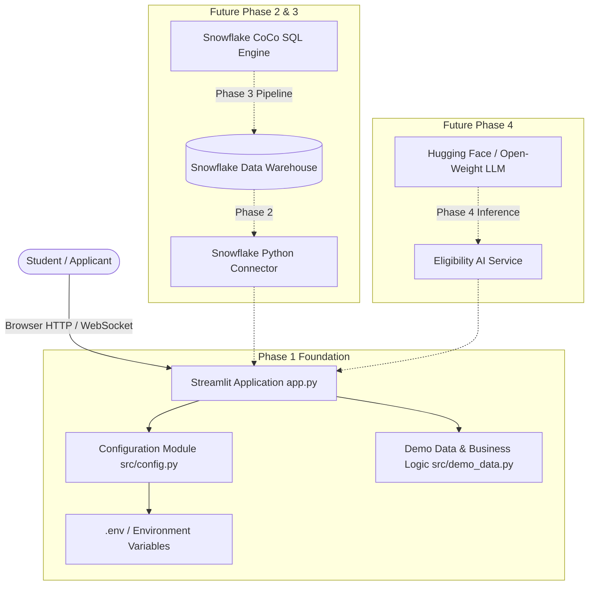

# OpportunityLens — System Architecture

**Tagline:** Find opportunities. Understand your chances. Take your next step.  
**Track:** Best Open-Source AI Project with Snowflake (Hacktoberfest Hack Day Gombe)

---

## 1. Executive Summary

OpportunityLens is an AI-powered opportunity discovery platform tailored for Nigerian tertiary students and early-career talents. The platform aggregates scholarships, internships, subsidized technical training programs, hackathons, and entry-level positions into a unified, searchable, and AI-assisted portal.

This project is built iteratively across distinct phases to demonstrate:
1. A real, freely accessible dataset hosted in Snowflake.
2. The practical application of Snowflake CoCo for SQL exploration, optimization, and pipeline generation.
3. An open-weight AI evaluation layer using Hugging Face Inference Providers / OpenAI-compatible APIs.
4. Clean, reproducible open-source software engineering.

---

## 2. Phase 1 Architecture (Current State)

Phase 1 establishes the user interface foundation, testing harness, and clean project configuration without prematurely introducing network dependencies or database credentials.

### Component Overview

### Modules in Phase 1

- **`app.py`**: Streamlit frontend implementing the blue-and-white accessible UI, search and filtering controls, opportunity cards, preview metrics, and placeholder sections for AI and analytics.
- **`src/config.py`**: Centralized configuration loader powered by `python-dotenv`. It safely loads configuration constants while keeping Snowflake and AI credentials isolated until their respective implementation phases.
- **`src/demo_data.py`**: Fictional, clearly labelled sample dataset modeling the target Snowflake schema. Contains pure, decoupled Python functions (`filter_opportunities`, `get_demo_metrics`) that can be tested in isolation without a running Streamlit server.
- **`tests/test_demo_data.py`**: Pytest test suite validating data integrity, required fields, canonical categories and statuses, sample data disclosures, search querying, and combined filtering.

---

## 3. Data Schema Design

The Phase 1 in-memory schema is structured to map directly to the target Snowflake table (`OPPORTUNITIES`) in Phase 2:

| Field Name | Type | Description |
| :--- | :--- | :--- |
| `opportunity_id` | `VARCHAR(64)` | Unique identifier (e.g., `DEMO-SCH-001`, transitioning to `OPP-2026-XXXX`). |
| `title` | `VARCHAR(255)` | Official title of the opportunity. |
| `category` | `VARCHAR(64)` | One of: `Scholarships`, `Internships`, `Tech Training`, `Hackathons`, `Entry-Level Jobs`. |
| `organization` | `VARCHAR(255)` | Sponsoring company, institution, or NGO. |
| `description` | `TEXT` | Concise summary of the offering and benefits. |
| `eligibility` | `TEXT` | Specific academic, geographic, or experience prerequisites. |
| `education_level`| `VARCHAR(128)` | Target educational standing (Undergraduate, Postgraduate, etc.). |
| `location` | `VARCHAR(128)` | City, state, or remote/hybrid classification in Nigeria. |
| `deadline` | `DATE` | Application closing date (ISO-8601: `YYYY-MM-DD`). |
| `source_url` | `VARCHAR(512)` | Official application link or verified source listing. |
| `verified_at` | `TIMESTAMP` | Timestamp when the opportunity was verified. |
| `status` | `VARCHAR(32)` | Application lifecycle: `Open`, `Closing Soon`, `Closed`. |
| `is_sample_data` | `BOOLEAN` | Explicit flag preventing fictional records from being misrepresented. |

---

## 4. Planned Integrations

### Phase 2: Snowflake Connection & Open Dataset
- Connect using `snowflake-connector-python`.
- Provision an open, freely accessible dataset detailing educational opportunities and tech programs relevant to Nigeria and West Africa.
- Implement a Snowflake repository service layer (`src/snowflake_client.py`) that executes read queries and falls back gracefully to cached or sample records on connection errors.

### Phase 3: Snowflake CoCo Pipeline & Analytics
- Leverage **Snowflake CoCo** (Cortex Code / Snowflake's intelligent assistant) to:
  - Generate optimized aggregation queries for opportunity metrics and regional distribution.
  - Formulate SQL data transformations for clean deduplication and status categorization (`Closing Soon` triggers).
  - Power interactive visualizations in the analytics section of `app.py`.

### Phase 4: Open-Weight AI Assistant
- Integrate an eligible open-weight model (such as `meta-llama/Llama-3.2-3B-Instruct`) hosted via **Hugging Face Inference Providers** using the OpenAI-compatible SDK.
- Feed retrieved opportunity criteria into structured prompts so students can receive tailored eligibility checks and actionable application advice without hallucinations.

---

## 5. Security & Isolation Principles

1. **Zero Committed Secrets**: All sensitive connection parameters reside in `.env`, which is strictly ignored by `.gitignore`.
2. **Defensive Defaults**: In the absence of credentials, the platform operates in a zero-network preview mode without throwing unhandled exceptions.
3. **Data Transparency**: All unverified or fictional data is explicitly badged to maintain trust with students and evaluators.
